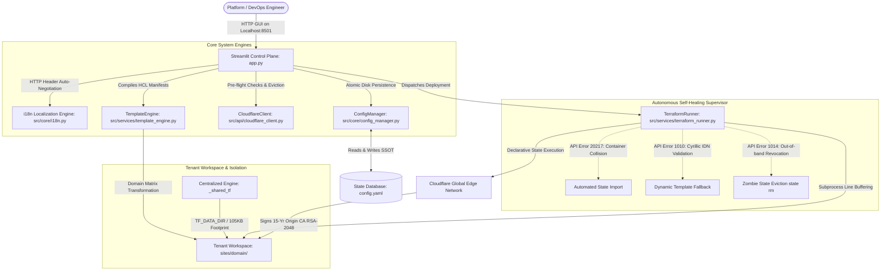

# ☁️ Cloudflare IaC Management Portal

[](https://www.python.org/)
[](https://registry.terraform.io/providers/cloudflare/cloudflare/latest)
[](https://streamlit.io/)
[](https://developers.cloudflare.com/api/)
[](LICENSE)

[🇷🇺 Перейти к полному руководству на русском языке (README_RU.md)](README_RU.md)

> **Enterprise-grade Infrastructure-as-Data (IaD) control plane** engineered for multi-tenant domain fleets. Bridges an interactive **Streamlit** administrative web interface, an autonomous **Python orchestration pipeline**, and declarative **HashiCorp Terraform v5.x** engines. Features zero-touch 15-year Cloudflare Origin CA certificate lifecycle automation, adaptive Free-tier WAF security suites, and autonomous self-healing state reconciliation.

---

## 📌 Table of Contents
1. [System Architecture](#1-system-architecture)
2. [Core Engineering Highlights](#2-core-engineering-highlights)
3. [Repository Topology](#3-repository-topology)
4. [Prerequisites & Installation](#4-prerequisites--installation)
5. [Cloudflare API Token Configuration](#5-cloudflare-api-token-configuration)
6. [Operational Manual & Workflows](#6-operational-manual--workflows)
7. [Self-Healing State Reconciliation Trio](#7-self-healing-state-reconciliation-trio)
8. [Origin CA vs Let's Encrypt Architecture](#8-origin-ca-vs-lets-encrypt-architecture)
9. [Enterprise Free-Tier WAF Hardening](#9-enterprise-free-tier-waf-hardening)
10. [Hosting Integration (ISPmanager / Nginx)](#10-hosting-integration-ispmanager--nginx)
11. [Post-Provisioning Manual Hardening Checklist](#11-post-provisioning-manual-hardening-checklist)
12. [Troubleshooting & FAQ](#12-troubleshooting--faq)
13. [License](#13-license)
---

## 1. System Architecture



---

## 2. Core Engineering Highlights

### 1. Infrastructure-as-Data (IaD) & Blast Radius Isolation
* **Separation of Concerns:** Eliminates raw HCL manipulation for day-to-day operations. Configuration parameters are stored in a human-readable Single Source of Truth (`config.yaml`).
* **Granular Blast Radius:** Each managed tenant maintains an isolated state (`sites/<domain>/terraform.tfstate`). State corruption, locking, or execution failures on a single domain cannot compromise adjacent tenants.
* **Persistent Override Protection:** Granular tenant overrides (`custom_settings`) are permanently preserved during global fleet synchronizations.

### 2. Disk & Memory Deduplication via `TF_DATA_DIR`
* Conventional multi-workspace Terraform setups download `~800MB` of provider plugins into every tenant workspace. For a fleet of 25 domains, this wastes over **20 GB** of storage and creates extreme network overhead during `init`.
* **Architectural Solution:** The orchestrator sets the `TF_DATA_DIR` environment variable to a centralized pre-initialized directory (`_shared_tf/.terraform`). Workspaces operate with **zero duplicate provider binaries**, reducing individual workspace storage down to **~105 KB** (a **99.98% disk reduction**).

### 3. Autonomous Self-Healing State Loops
The execution supervisor continuously intercepts downstream provider errors and executes corrective actions in real time:
* **Error 20217 (Ruleset Phase Collision):** When Cloudflare pre-creates default ruleset containers, creation throws 20217. The engine queries the REST API v4, maps phase identifiers, executes `terraform import`, and redeploys smoothly.
* **Error 1010 (IDN Wildcard Hostname Rejection):** Cloudflare Origin CA rejects wildcard SANs (`*.xn--...`) on select Cyrillic internationalized zones. The engine switches on `no_wildcard=True`, dynamically re-renders manifests, and converges state.
* **Error 1014 (Out-of-band Certificate Revocation):** When certificates are manually deleted via the Cloudflare web UI, local state contains dead references. The engine purges the dead resource via `terraform state rm` and provisions fresh cryptographic keys.

### 4. Domain Representation Matrix
The compiler manages three distinct representations for every domain:
1. **UTF-8 (Human / SANs):** Passed directly to Cloudflare Origin CA to preserve accurate internationalized certificate names.
2. **Punycode (IDNA ASCII):** Passed to Cloudflare DNS and routing expressions (`xn--...`) to comply with RFC 3492.
3. **Slugified Latin:** Converted via phonetic transliteration for folder structures in `sites/`, guaranteeing POSIX filesystem safety across Windows, Linux, and Docker environments.

---

## 3. Repository Topology

```text
cloudflare-iac-portal/
├── config/
│   └── config.example.yaml      # Sanitized bilingual schema template for public Git tracking
├── src/
│   ├── api/
│   │   └── cloudflare_client.py # Cloudflare REST API v4 client (pre-flight checks, zones, cache)
│   ├── core/
│   │   ├── config_manager.py    # Atomic YAML serializer ensuring UTF-8 and zero Git diff churn
│   │   └── i18n.py              # Zero-dependency localization engine (Never-Crash UI pattern)
│   ├── locales/
│   │   ├── en.yaml              # Complete English translation catalog
│   │   └── ru.yaml              # Complete Russian translation catalog
│   └── services/
│       ├── template_engine.py   # Jinja2 HCL compiler & Domain Representation Matrix
│       └── terraform_runner.py  # Self-healing process supervisor & line-buffering streaming sink
├── _templates/                  # Declarative Jinja2 HCL templates (.tf.j2)
│   ├── dns_rules.tf.j2          # Authoritative apex (@) and www A-records
│   ├── firewall_rulesets.tf.j2  # 5-rule WAF suite + Rate Limiting module
│   ├── ip_access_rules.tf.j2    # Zero-quota IP Access allowlist rules
│   ├── origin_ssl.tf.j2         # Automated 15-year Origin CA certificate & RSA-2048 keypair
│   ├── provider.tf.j2           # Provider registry declarations (Cloudflare v5.x, TLS, Local)
│   ├── redirect_rules.tf.j2     # Single Redirect edge dynamic forwarding rulesets
│   ├── variables.tf.j2          # Scoped tenant variable declarations
│   └── zone_settings.tf.j2      # Transport layer security & TLS 1.3 edge baseline
├── _shared_tf/                  # Centralized Terraform core (TF_DATA_DIR execution hub)
├── tf_plugin_cache/             # Shared global filesystem cache for downloaded provider binaries
├── sites/                       # Isolated tenant workspaces (ignored in Git tracking)
├── app.py                       # Pure ID-driven Streamlit control plane orchestrator
├── run_manager.bat              # One-click Windows startup script (UTF-8 console enabled)
├── requirements.txt             # Pinned Python package dependencies
├── .env.example                 # Environment variables blueprint
└── LICENSE                      # MIT Open Source License
```

---

## 4. Prerequisites & Installation

### 1. System Requirements
* **Python 3.10, 3.11, 3.12, 3.13, or 3.14+**
* **HashiCorp Terraform CLI binary** (`v1.6+` or compatible with Cloudflare provider `v5.x`).

### 2. Environment Bootstrap
```bash
# Clone the repository
git clone https://github.com/your-username/cloudflare-iac-portal.git
cd cloudflare-iac-portal

# Initialize virtual environment
python -m venv .venv

# Activate environment
# On Windows (cmd/bat):
call .venv\Scripts\activate.bat
# On Linux/macOS:
source .venv/bin/activate

# Upgrade pip and install pinned dependencies
python -m pip install --upgrade pip
pip install -r requirements.txt
```

### 3. Binary Placement
Download the official [HashiCorp Terraform CLI](https://www.terraform.io/downloads) (Windows AMD64 executable or matching OS binary) and place `terraform.exe` directly into the project root directory:
```text
cloudflare-iac-portal/terraform.exe
```

---

## 5. Cloudflare API Token Configuration

To grant the orchestrator authority to manage zones, WAF rules, and certificates, create a dedicated scoped API token:

1. Navigate to: [Cloudflare API Tokens Dashboard](https://dash.cloudflare.com/profile/api-tokens) (**My Profile ➔ API Tokens ➔ Create Token**).
2. Select **Custom token ➔ Get started**.
3. Set **Token name** (e.g., `IaC Management Portal`).
4. In the **Permissions** matrix, configure all 10 mandatory rules:

| Category (Scope) | Target Context | Access Level | Architectural Justification |
| :--- | :--- | :--- | :--- |
| **Account** | `Account Settings` | **Read** | 🚨 **MANDATORY:** Resolves Account ID dynamically via REST API for zone provisioning. |
| **Zone** | `Zone` | **Edit** | Authorizes DNS zone discovery and new tenant onboarding. |
| **Zone** | `DNS` | **Edit** | Provisions authoritative A-records (`@` and `www`). |
| **Zone** | `DNS Settings` | **Edit** | Manages zone-level resolver and DNSSEC parameters. |
| **Zone** | `Zone Settings` | **Edit** | Enforces TLS 1.3, Always HTTPS, Security Level, and BIC toggles. |
| **Zone** | `Zone WAF` | **Edit** | 🚨 **MANDATORY:** Accesses Rulesets API v5. Prevents HTTP 403 on custom firewall deployment. |
| **Zone** | `SSL and Certificates`| **Edit** | 🚨 **MANDATORY:** Authorizes signing of 15-year Origin CA RSA-2048 certificates. |
| **Zone** | `Single Redirect` | **Edit** | Provisions dynamic 301 URI forwarding rulesets for mirror domains. |
| **Zone** | `Firewall Services` | **Edit** | Configures zone-level HTTP Rate Limiting rules against bruteforce attacks. |
| **Zone** | `Page Rules` | **Edit** | Grants legacy page rule management compatibility. |

5. Under **Account Resources**, select: `Include | All accounts`.
6. Under **Zone Resources**, select: `Include | All zones`.
7. Click **Continue to summary ➔ Create Token** and copy the secret token string.

### 4. Initialize Local Secrets
```bash
# Copy example template
cp .env.example .env
```
Open `.env` and paste your secret token:
```env
CLOUDFLARE_API_TOKEN="your_actual_token_here"
```

---

## 6. Operational Manual & Workflows

### Launching the Portal
```bash
# On Windows, double-click run_manager.bat or run:
streamlit run app.py
```
Access the application at `http://localhost:8501`. The control plane inspects the client's `Accept-Language` HTTP header and automatically loads English or Russian.

### Tab 1: Projects (Dashboard)
* **Real-time Health Audits:** Displays operational cards with status badges (🟢 Active / 🔴 Inactive), CMS tags, real server IPs, and Zone IDs.
* **Certificate Badges:** `[🔒 Origin CA (15 yrs)]` (active and pinned), `[🛡️ Custom SSL]` (override protected), `[⚪ No SSL Issued]` (pending first deployment).
* **Topology Correlation:** Displays hierarchical mirror trees underneath their primary parent domains:
  `└── 🟢 ↪️ mirror.com (Redirect to example.com/promo)`

### Tab 2: Zone Settings & Bulk Fleet Synchronization
* **Dedicated Task Filtering (`🔀 Redirects Only`):**
  * *Unchecked:* Displays primary web vitrines. Mass updates target security policies, WAF, and SSL certificates for main websites while skipping mirrors.
  * *Checked:* Displays redirect mirrors. Hides security forms and generates DNS A-records and Single Redirect rulesets in a single bulk sweep.
* **Granular Policy Override:** Modifying a setting on a specific domain saves an override in `custom_settings`. Global fleet updates respect individual overrides unless explicitly cleared via the **Reset to Global Defaults** button.
* **Reactive SSL Origin CA Management:** The SSL controls operate outside blocking forms (`st.form`). Checking **Force reissue** or toggling **Custom SSL** persists immediately and primes Terraform without intermediary clicks.

### Tab 3: Add Domain / Project Onboarding
* **Domain Normalization:** Translates Cyrillic domains (e.g., `домен.бел`) into ASCII Punycode automatically.
* **CMS Architecture Profiling:** Generates tailored configurations for Joomla, WordPress, PrestaShop 1.6, PrestaShop 1.7/8.x, or Static HTML.
* **Zero-Touch Provisioning:** Direct REST API calls register the zone on Cloudflare, fetch designated nameservers, configure the Single Source of Truth (`config.yaml`), and output nameservers for domain registrar configuration.

### Tab 4: Firewall (WAF) & Access Control
* **Zero-Quota IP Allowlists (IP Access Rules):** Whitelists office and administrator IP addresses without consuming the strict Free-tier limit of 5 WAF rules. Includes a single-click **Detect My Current IP** lookup utility.
* **Full Expression Editor:** Provides fine-grained editing for all 5 security rules and rate-limiting thresholds with automated syntax validation and factory reset capabilities.

### Tab 5: Admin Utilities (Edge Cache Eviction)
* Executes instant cache invalidation (`Purge Everything`) across all worldwide Cloudflare Edge PoPs via direct REST API calls in `<500ms`, bypassing Terraform state execution.

---

## 7. Self-Healing State Reconciliation Trio

The `TerraformRunner` (`src/services/terraform_runner.py`) encapsulates automated recovery circuits for the three most common Cloudflare provider failures:

| Failure Mode & Error Code | Root Cause / API Behavior | Autonomous Self-Healing Action |
| :--- | :--- | :--- |
| **Error 20217**<br>`Ruleset Collision` | Cloudflare auto-provisions hidden empty ruleset containers upon zone activation. Subsequent declarative creation throws 20217. | Runner catches 20217, queries `GET /zones/{id}/rulesets`, maps phases to HCL resource names, executes targeted `terraform import`, and retries. |
| **Error 1010**<br>`Cyrillic Wildcard Rejection` | Cloudflare Origin CA fails to validate wildcard certs (`*.domain`) for specific IDN/Cyrillic zones (`.бел` / `.рф`). | Runner catches 1010, calls back `TemplateEngine` with `no_wildcard=True`, dynamically regenerates HCL manifests, and redeploys without interruption. |
| **Error 1014**<br>`Out-of-band Revocation Drift` | Certificate was deleted or revoked manually via the Cloudflare web UI. Local Terraform state holds a dead zombie resource causing 1014 during refresh. | Runner catches 1014, invokes `terraform state rm` to evict the zombie state reference, requests fresh cryptographic keypairs, and converges state. |

---

## 8. Origin CA vs Let's Encrypt Architecture

Running conventional Let's Encrypt certificates on origin servers behind a Cloudflare proxy introduces fragility: ACME HTTP-01 challenges fail when WAF rules block bots, and renewals fail every 90 days.

```text
Client Browser ────[ Strict HTTPS ]────► Cloudflare Edge ────[ 15-Year RSA-2048 ]────► Origin Server
 (Edge Certificate via CDN)               (Full Strict Mode)                      (No Renewals to 2041)
```

### The Solution:
1. Terraform locally provisions an uncompromised private key using `tls_private_key` (RSA-2048).
2. Generates an in-memory CSR via `tls_cert_request`.
3. Cloudflare Origin CA signs an official **15-year certificate (5475 days validity)**.
4. The keypair is securely persisted to `sites/<domain>/ssl/cert.pem` and `sites/<domain>/ssl/key.pem`.
5. Edge SSL is locked to **Full (Strict)** mode: origin traffic is fully encrypted with zero maintenance required until 2041.

---

## 9. Enterprise Free-Tier WAF Hardening

Cloudflare Free-tier zones enforce strict engine limits: **maximum 5 Custom Rules + 1 Rate Limiting rule**, and **prohibit regex evaluation** (`matches` returns HTTP 400).

Our Jinja2 template (`_templates/firewall_rulesets.tf.j2`) optimizes protection within these constraints via **Boolean Signature Decomposition**:

```text
[RULE 1: Geo-Filter]     ──► Managed Challenge for non-target countries (SEO bots exempt)
[RULE 2: Global Exploit] ──► Block: empty User-Agents, scanners, SQLi, XSS, dumps (.sql, .zip, .env)
[RULE 3: Threat Score]   ──► Managed Challenge for IPs with Cloudflare threat reputation > 14
[RULE 4: CMS Core Guard] ──► Block: sensitive config files and arbitrary PHP execution in uploads
[RULE 5: Admin Gateway]  ──► Managed Challenge on administrative URIs (/administrator/, /wp-admin/)
[RATE LIMITING MODULE]   ──► Block on sliding window exceeding 100 requests per 10 seconds
```

---

## 10. Hosting Integration (ISPmanager / Nginx)

### Installing Origin CA Certificates in ISPmanager
1. Open the domain card in the portal and expand **View generated SSL keys for hosting**.
2. In **ISPmanager**, navigate to: **System ➔ SSL Certificates ➔ Add Certificate**.
3. Choose **Existing certificate**.
4. Populate fields:
   * **SSL Certificate:** Paste the contents of `cert.pem`.
   * **Private Key:** Paste the contents of `key.pem`.
   * **Certificate Chain (CA Bundle):** **LEAVE EMPTY.** (Cloudflare verifies Origin certificates against its internal root authority; intermediate chains are unnecessary).
5. In **WWW ➔ WWW Domains**, open site properties, enable **SSL**, select the new certificate, and toggle **Redirect HTTP to HTTPS**.

### Domain Mirrors (Redirects)
> [!TIP]
> **Zero Hosting Footprint:** Domain mirrors are redirected entirely at Cloudflare's Anycast Edge via 301 Single Redirect rulesets. Inbound HTTP requests never reach your server. You can safely remove redirect domains and empty folders from your hosting panel!

---

## 11. Post-Provisioning Manual Hardening Checklist

> [!IMPORTANT]
> **Free-Tier API Restriction Note:**
> Cloudflare intentionally restricts programmatic API/Terraform access to Bot Management and Page Shield on Free-tier zones (returning `HTTP 403 / Feature not available via API`).
> However, Cloudflare **grants full access to activate these enterprise-grade defenses manually via the Web UI**. Complete this one-time 2-minute checklist after executing Terraform:

| Cloudflare Dashboard View | Targeted Security Feature | Recommended Value & Operational Impact |
| :--- | :--- | :--- |
| **Security ➔ Settings** | `Bot Fight Mode` | **`[ON]`** Automated heuristic Layer 7 botnet drop |
| **Security ➔ Settings** | `AI Labyrinth` | **`[ON]`** Honeypot crawl traps exhausting scraper botnets |
| **Security ➔ Settings** | `Continuous Script Monitor` | **`[ON]`** Client-side Page Shield Lite Magecart tamper audit |
| **AI Crawl Control** | `AI Model Training Scrapers` | **`[Block]`** Prohibits proprietary content scraping by LLMs |
| **CMS Core (Joomla/Nginx)** | `Behind Reverse Proxy` | **`[Yes]`** Restores actual client IPs via `CF-Connecting-IP` |

---

### Step 1. Heuristic Bot Defense & AI Crawler Tarpits (`Security ➔ Settings`)
Navigate to: **Security ➔ Settings** and scroll to the bottom:
1. **Bot Fight Mode = `ON`** — Executes automated heuristic evaluations against anomalous HTTP request patterns, immediately mitigating Layer 7 scrapers, credential stuffers, and low-and-slow DDoS probes.
2. **AI Labyrinth = `ON`** — Deploys hidden, dynamically generated honeypot links into HTML streams. Automated web crawlers and scraping engines become trapped in an infinite recursive crawl loop, exhausting botnet resources while protecting origin bandwidth.

---

### Step 2. Client-Side Supply Chain Security (`Security ➔ Settings`)
Within the same view, locate the **Page Shield Lite / Continuous Script Monitoring** block:
* Toggle **Continuous script monitoring = `ON`**.
* Cloudflare edge nodes hash, inventory, and continuously baseline every client-side JavaScript asset loaded on your pages. If an attacker injects unauthorized JavaScript (such as e-skimming Magecart malware or formjackers), Cloudflare dispatches real-time email security alerts identifying the malicious resource URI.

---

### Step 3. AI Scraping & Intellectual Property Governance (`AI Crawl Control`)
Navigate to the sidebar: **AI Crawl Control ➔ Security**:
* **Search Engines (Google, Bing, Yandex):** Keep **`Allow`** (Preserves organic SEO indexing without disruption).
* **AI Model Training:** Switch to **`Block`** (Prohibits unauthorized scraping from automated LLM crawlers including GPTBot, CCBot, Anthropic, and Bytespider).
* **Block training in robots.txt:** Toggle to **`ON`** (Edge nodes inject defensive `User-agent: * Disallow` headers directly into synthetic robots.txt responses).

---

### Step 4. Reverse Proxy Real-IP Restoration in CMS Backends
Because all incoming traffic is proxied through Cloudflare Anycast edge nodes, web applications see Cloudflare edge IPs instead of actual visitor IPs by default.

#### 1. For Joomla CMS:
1. Open the administrator console: **System ➔ Global Configuration ➔ Server**.
2. Locate the **Proxy Settings** panel:
   * Toggle **Behind Load Balancer / Reverse Proxy = `Yes`**.
3. Save configuration. Joomla now resolves actual client IPv4/IPv6 addresses from the `CF-Connecting-IP` request header across audit logs and checkout workflows.

#### 2. RSFirewall Protection Plugin (Joomla):
* Do not disable the extension, but delegate geo-blocking and high-rate packet filtering entirely to the Cloudflare WAF.
* In RSFirewall configuration, enable the **Cloudflare Support (Use Real IP Headers)** toggle.

#### 3. For WordPress / PrestaShop:
* Ensure your origin web server utilizes Nginx `set_real_ip_from` or Apache `mod_remoteip` targeting Cloudflare's published public IP ranges, ensuring internal security plugins log accurate visitor identities.

---

## 12. Troubleshooting & FAQ

#### Q: How do I handle corporate or regional network blocks to registry.terraform.io?
**A:** The portal features built-in network diagnostics. If direct connectivity is blocked, open the **Network Routing** expander in Zone Settings and select an active regional mirror (e.g., *Selectel*, *TF.org.ru*, *Yandex Cloud*). The portal dynamically writes a local `terraform.rc` configuration injecting the mirror without mutating system-level settings.

#### Q: What happens to domain email (Google Workspace, Yandex 360, Mail.ru)?
**A:** Mail protocols (SMTP/IMAP/POP3) cannot traverse the Cloudflare HTTP proxy. The portal manages only apex (`@`) and `www` A-records. Pre-existing MX, SPF (TXT), and DKIM records are **never modified or removed**. Always verify that MX and mail records are configured with **DNS Only (Grey Cloud)** in the Cloudflare dashboard.

#### Q: Why did DNS records not appear immediately after adding a domain?
**A:** By design. The **Add Domain** tab only handles zone registration and nameserver discovery. Authoritative DNS records, SSL certificates, and WAF rulesets are compiled and deployed together when executing Terraform from the **Zone Settings** tab.

---

## 13. License

This project is licensed under the MIT License - see the [LICENSE](LICENSE) file for details.