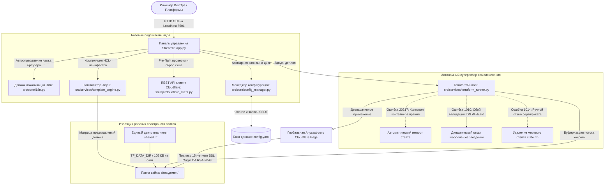

# 📖 Руководство пользователя: Cloudflare IaC Management Portal

[](https://www.python.org/)
[](https://registry.terraform.io/providers/cloudflare/cloudflare/latest)
[](https://streamlit.io/)
[](https://developers.cloudflare.com/api/)
[](LICENSE)

[English Version (README.md)](README.md)

> **Профессиональный портал администратора уровня Enterprise** для централизованного управления инфраструктурой Cloudflare (IaC / IaD), автоматической генерации 5-уровневого фаервола WAF для CMS и выпуска 15-летних SSL-сертификатов без обслуживания.

---

## 📌 Оглавление
1. [Архитектура системы](#1-архитектура-системы)
2. [Ключевые инженерные решения](#2-ключевые-инженерные-решения)
3. [Установка и первичное развертывание](#3-установка-и-первичное-развертывание)
4. [Создание API Токена со всеми правами в Cloudflare](#4-создание-api-токена-со-всеми-правами-в-cloudflare)
5. [Топология папок и экономия диска (TF_DATA_DIR)](#5-топология-папок-и-экономия-диска-tf_data_dir)
6. [Пошаговое руководство по веб-интерфейсу](#6-пошаговое-руководство-по-веб-интерфейсу)
7. [Массовое обновление: Основные сайты vs Редиректы](#7-массовое-обновление-основные-сайты-vs-редиректы)
8. [Фаервол (WAF) и Белые списки IP](#8-фаервол-waf-и-белые-списки-ip)
9. [Установка 15-летнего SSL в ISPmanager](#9-установка-15-летнего-ssl-в-ispmanager)
10. [Почта на домене (Яндекс 360), безопасный FTP и ручные настройки](#10-почта-на-домене-яндекс-360-безопасный-ftp-и-ручные-настройки)
11. [Чек-лист ручного «дожима» безопасности в Cloudflare и CMS](#11-чек-лист-ручного-дожима-безопасности-в-cloudflare-и-cms)
12. [Инструменты: Мгновенная очистка кэша (Purge Cache)](#12-инструменты-мгновенная-очистка-кэша-purge-cache)
13. [Авто-исцеление ошибок Terraform (Self-Healing FAQ)](#13-авто-исцеление-ошибок-terraform-self-healing-faq)
14. [Лицензия](#14-лицензия)

---

## 1. Архитектура системы



---

## 2. Ключевые инженерные решения

### 1. Концепция Infrastructure as Data (IaD) и изоляция аварий
* **Единый источник правды (`config.yaml`):** Все параметры сайтов, IP-адреса, движки и переопределения безопасности хранятся в единой базе данных YAML. Никакого ручного написания сложного HCL-кода.
* **Изоляция аварийного радиуса (Blast Radius):** Под каждый сайт создается отдельная папка в `sites/<домен>/` со своим личным `terraform.tfstate`. Сбой на одном сайте физически не способен повлиять на другие домены.
* **Защита индивидуальных настроек:** Персональные переопределения сайтов (`custom_settings`) надежно защищены от случайного затирания при массовых обновлениях всей базы.

### 2. Колоссальная экономия диска (`TF_DATA_DIR`)
* По умолчанию Terraform скачивает тяжелые бинарные файлы плагинов (~800 МБ) в папку каждого сайта. Для 25 доменов это потребовало бы более **20 Гигабайт** диска!
* **Решение:** Благодаря системной переменной `TF_DATA_DIR = _shared_tf/.terraform`, все сайты используют единые скомпилированные плагины из памяти. Папка каждого сайта на диске весит всего **~105 КБ**, а вся база из 25 сайтов занимает **менее 3 Мегабайт** (экономия диска **99.98%**).

### 3. Автономные контуры самовосстановления стейта
Раннер выполнения непрерывно перехватывает специфичные сбои Cloudflare API и автоматически восстанавливает работоспособность прямо во время выполнения:
* **Ошибка 20217 (Rulesets Collision):** Обнаруживает скрытые предсозданные контейнеры правил, опрашивает REST API Cloudflare, сопоставляет фазы и выполняет автоматический `terraform import`.
* **Ошибка 1010 (IDN Wildcard Rejection):** Cloudflare API отклоняет поддоменную звездочку (`*.`) при заказе Origin CA на некоторых кириллических доменах (`.бел` / `.рф`). Раннер на лету генерирует манифест с `no_wildcard=True` и успешно выпускает сертификат со второго прогона.
* **Ошибка 1014 (Out-of-band Revocation):** Если сертификат был удален вручную в браузере, в файле стейта остается мертвая запись. Раннер удаляет зомби-ресурс командой `terraform state rm` и чисто выпускает свежую пару ключей.

### 4. Матрица представлений домена (Domain Representation Matrix)
Система автоматически разделяет доменное имя на 3 сущности:
1. **UTF-8 (Для людей и сертификатов):** Передается в Cloudflare Origin CA для сохранения оригинального имени в Subject Alternative Names (SAN).
2. **Punycode (IDNA ASCII):** Передается в API DNS и правила маршрутизации (`xn--...`) в соответствии со стандартом RFC 3492.
3. **Slugified Latin:** Транслитерируется для создания папок в `sites/`, гарантируя совместимость с файловыми системами Windows, Linux и Docker-контейнерами.

---

## 3. Установка и первичное развертывание

Перед первым запуском проекта на новом компьютере необходимо развернуть рабочее окружение:

### Шаг 1. Клонирование репозитория и окружение Python
Откройте командную строку (`cmd`) в корневой папке проекта:

```cmd
:: 1. Создаем изолированное виртуальное окружение
python -m venv .venv

:: 2. Активируем его
call .venv\Scripts\activate.bat

:: 3. Обновляем менеджер пакетов pip и устанавливаем зависимости
python -m pip install --upgrade pip
pip install -r requirements.txt
```

### Шаг 2. Размещение бинарного файла Terraform
1. Скачайте официальный архив [HashiCorp Terraform CLI](https://www.terraform.io/downloads) (версия для Windows AMD64).
2. Распакуйте исполняемый файл `terraform.exe` прямо в корень папки проекта:
   ```text
   cloudflare-iac-portal/terraform.exe
   ```

---

## 4. Создание API Токена со всеми правами в Cloudflare

Для того чтобы скрипт мог автоматически создавать зоны, управлять DNS, настраивать WAF и заказывать сертификаты, токену необходимы точные права доступа:

1. Перейдите в раздел управления токенами: [Cloudflare API Tokens](https://dash.cloudflare.com/profile/api-tokens) (**My Profile ➔ API Tokens ➔ Create Token**).
2. В самом низу страницы найдите блок **Custom token** и нажмите **Get started**.
3. Задайте имя токена в поле **Token name** (например, `IaC Management Portal`).
4. В блоке **Permissions** добавьте все 10 обязательных правил:

| Категория (Scope) | Область (Context) | Право (Access) | Зачем это нужно (Техническое обоснование) |
| :--- | :--- | :--- | :--- |
| **Account** | `Account Settings` | **Read** | 🚨 **КРИТИЧЕСКИ ВАЖНО!** Позволяет скрипту узнать ваш Account ID для автоматической регистрации новых доменов через API. |
| **Zone** | `Zone` | **Edit** | Чтение существующих зон и регистрация новых доменов на аккаунте. |
| **Zone** | `DNS` | **Edit** | Создание и обновление A-записей (`@` и `www`). |
| **Zone** | `DNS Settings` | **Edit** | Управление параметрами резолвера и настройками зоны. |
| **Zone** | `Zone Settings` | **Edit** | Переключение HTTPS, TLS 1.3, BIC и Security Level. |
| **Zone** | `Zone WAF` | **Edit** | 🚨 **КРИТИЧЕСКИ ВАЖНО!** Доступ к Rulesets API v5. Без этого фаервол упадет с ошибкой `403 Forbidden`. |
| **Zone** | `SSL and Certificates`| **Edit** | 🚨 **КРИТИЧЕСКИ ВАЖНО!** Позволяет Terraform автоматически подписывать и выпускать 15-летние сертификаты Origin CA. |
| **Zone** | `Single Redirect` | **Edit** | Создание правил динамического 301-перенаправления для доменов-зеркал. |
| **Zone** | `Firewall Services` | **Edit** | Управление правилами Rate Limiting (защита от перебора паролей). |
| **Zone** | `Page Rules` | **Edit** | Поддержка традиционных правил страниц. |

5. В блоке **Account Resources** выберите: `Include | All accounts`.
6. В блоке **Zone Resources** выберите: `Include | All zones`.
7. Нажмите **Continue to summary ➔ Create Token** и скопируйте секретный токен.

### Инициализация файла секретов (.env)
1. Создайте рабочий файл `.env` из шаблона:
   ```cmd
   copy .env.example .env
   ```
2. Откройте `.env` блокнотом и вставьте скопированный токен:
   ```env
   CLOUDFLARE_API_TOKEN="ваш_секретный_токен_здесь"
   ```

---

## 5. Топология папок и экономия диска (TF_DATA_DIR)

```text
cloudflare-iac-portal\
│
├── .env                       # Секретный токен API (в .gitignore)
├── .env.example               # Публичный шаблон переменных окружения
├── config.yaml                # База данных всех ваших сайтов (в .gitignore)
├── config.example.yaml        # Обезличенный пример базы для Git
├── terraform.exe              # Исполняемый файл движка HashiCorp
├── run_manager.bat            # Ярлык запуска в 1 клик (с поддержкой UTF-8)
│
├── _shared_tf/                # Единый мастер-центр провайдеров (TF_DATA_DIR)
│   ├── provider.tf            # Общая конфигурация плагинов
│   └── .terraform/            # ЕДИНСТВЕННЫЙ экземпляр бинарников на весь диск!
│
├── tf_plugin_cache/           # Кэш пакетов провайдеров
│
├── src/                       # Модульный исходный код на Python
│   ├── api/cloudflare_client.py   # REST API клиент Cloudflare v4
│   ├── core/config_manager.py     # Атомарный менеджер YAML
│   ├── core/i18n.py               # Движок мультиязычности (Never-Crash UI)
│   ├── locales/                   # Словари интерфейса (en.yaml, ru.yaml)
│   └── services/template_engine.py# Компилятор Jinja2 шаблонов
│   └── services/terraform_runner.py# Раннер с циклами самовосстановления
│
├── _templates/                # Эталонные HCL-шаблоны Jinja2 (.tf.j2)
│
└── sites/                     # Изолированные папки сайтов (ВЕСЯТ ВСЕГО ~105 КБ!)
    ├── example.com/
    │   ├── ssl/               # 15-летние ключи cert.pem и key.pem для хостинга
    │   ├── terraform.tfstate  # Память стейта конкретного сайта
    │   └── *.tf               # Текстовые конфигурации (~105 КБ)
    └── redirect-mirror.com/   # Изолированные папки доменов-зеркал
```

---

## 6. Пошаговое руководство по веб-интерфейсу

### Ежедневный запуск панели
Дважды кликните по ярлыку **`run_manager.bat`** в корне проекта. Откроется браузер по адресу `http://localhost:8501`. Язык интерфейса определится автоматически по заголовку браузера `Accept-Language`.

---

### Вкладка 1: «🔀 Проекты (Дашборд)»
Главная витрина ваших ресурсов:
* **Индикаторы:** 🟢 Активен в Terraform | 🔴 Выключен.
* **Бейджи движков:** `[JOOMLA]`, `[WORDPRESS]`, `[PRESTASHOP_1_6]`, `[PRESTASHOP_1_7]`.
* **Статус SSL-сертификата:**
  * `[🔒 Origin CA (15 лет)]` — сертификат выпущен и готов к установке.
  * `[🛡️ Свой SSL]` — сайт защищен страховкой от перезаписи сертификата.
  * `[⚪ SSL не выпущен]` — ожидает генерации при следующем запуске Terraform.
* **Дерево зеркал:** Домены-редиректы наглядно сгруппированы под целевыми сайтами:
  `└── 🟢 ↪️ mirror.by (Редирект на udarnik.by/ponsse)`

---

### Вкладка 2: «⚙️ Настройки Зоны»
Управление параметрами периметра Cloudflare для одного сайта или всех сайтов сразу.

#### Описание ключевых параметров безопасности:
* **Always Use HTTPS:** Автоматический 301-редирект с незащищенного HTTP на HTTPS на серверах Cloudflare.
* **Browser Integrity Check (BIC):** Анализ заголовков HTTP-запросов и отсечение вредоносных ботов без валидного User-Agent.
* **Email Obfuscation:** Шифрование адресов электронной почты на страницах с помощью динамического JavaScript для защиты от спам-парсеров.
* **Security Level:** Рекомендуется значение `essentially_off` (вся точечная фильтрация возлагается на кастомный WAF).
* **Minimum TLS Version:** Рекомендуется `1.2`. Отсекает устаревшие протоколы TLS 1.0 и 1.1 в соответствии с международным стандартом безопасности PCI DSS.
* **Регионы доступа (Гео-блок):** Адаптивная фильтрация стран (`Беларусь, Россия и Европа`, `Беларусь и Россия`, `Только Беларусь`).

#### 🔒 Реактивное управление SSL Origin CA (15 лет):
Блок расположен прямо под формой и работает **на лету без необходимости сохранять форму**:
* **Автоматический выпуск:** Если сертификат еще не выпущен, система автоматически сгенерирует приватный ключ RSA-2048, отправит CSR в Cloudflare и сохранит готовый 15-летний сертификат при первом запуске Terraform.
* **Чекбокс «🔄 Принудительно перевыпустить»:** Поставьте галочку и сразу нажимайте кнопку запуска Terraform — сертификат будет мгновенно перевыпущен и перезаписан на диске.
* **Просмотр ключей:** Спойлер *«📄 Просмотреть SSL-ключи для хостинга»* позволяет в 1 клик скопировать `cert.pem` и `key.pem` для вставки в панель хостинга (ISPmanager).

---

### Вкладка 3: «➕ Добавить домен»
Позволяет добавить новый проект в систему за 30 секунд:

1. **Имя домена:** Введите адрес сайта (например, `udarnik.by` или кириллицей `домен.бел`). Кириллица конвертируется в Punycode автоматически.
2. **Тип домена:** Выберите *Основной сайт (Main)* или *Домен-зеркало (Redirect)*.
3. **Параметры редиректа:** Для зеркал укажите целевой сайт и внутренний путь (например, `/promo`).
4. **CMS / Архитектура:** Укажите движок сайта для выбора правильного набора WAF-правил.
5. **IP-адрес сервера:** IPv4 адрес хостинга для A-записей `@` и `www`.
6. **Стратегия SSL:** Выберите выпуск 15-летнего Origin CA или установите флаг «Свой сертификат» (страховка от перезаписи).
7. **Способ привязки:**
   * *Создать автоматически (Через API)* — скрипт сам зарегистрирует домен в Cloudflare и выведет в рамочках два NS-сервера. Скопируйте их и пропишите у регистратора домена.
   * *Уже добавлен в Cloudflare* — ручной ввод существующего Zone ID.

---

### Вкладка 4: «🛡️ Фаервол (WAF)»
Управление 5-уровневым комплексом WAF и белыми списками доверенных IP:
* **Белый список IP (IP Access Rules):** Доверенные IP-адреса пропускаются мимо всех проверок и капч. **НЕ расходует лимит из 5 правил WAF!** Кнопка «📍 Мой текущий IP» определяет ваш адрес за 1 секунду.
* **Редактор выражений:** Позволяет просматривать и вручную модифицировать формулы Wirefilter для каждого из 5 правил фаервола и модуля Rate Limiting.
* **Авто-сохранение:** Кнопка «🚀 Сохранить и применить фаервол в Terraform» автоматически сохраняет изменения в `config.yaml` и мгновенно применяет их на серверах Cloudflare.

---

### Вкладка 5: «🛠️ Инструменты»
* **Мгновенный сброс кэша Cloudflare (Purge Everything):** Позволяет сбросить кэшированные стили, скрипты и картинки для выбранного сайта или для всех основных сайтов разом за полсекунды напрямую через REST API.
* **Вывод из эксплуатации и каскадное удаление (Decommissioning):** Чистый демонтаж сайтов. Поддерживает разделение на основные сайты и зеркала через тумблер «🔀 Только редиректы», снос ресурсов через `terraform destroy`, удаление зоны через API Cloudflare, физическое удаление папки с диска и каскадное удаление всех зависимых зеркал в один клик.

---

## 7. Массовое обновление: Основные сайты vs Редиректы

Чекбокс **«🔀 Только редиректы»** в настройках зоны разделяет задачи и ускоряет работу в 10 раз:

### Сценарий А. Обновление основных сайтов (Чекбокс снят)
В выпадающем списке выбран пункт **«🌐 Все ОСНОВНЫЕ сайты»**. Terraform обновляет настройки безопасности, фаервол и выпускает сертификаты **исключительно для сайтов-витрин**. Домены-зеркала полностью игнорируются, экономя время.

### Сценарий Б. Массовое обновление зеркал (Чекбокс включен)
В списке выбран пункт **«🌐 Все РЕДИРЕКТЫ»**. Форма настроек WAF скрывается (зеркалам она не нужна). Нажатие кнопки Terraform создает для всей пачки зеркал DNS A-записи и правила Single Redirect (`301 Moved Permanently`).

### Точечный приоритет настроек (`custom_settings`):
* В личные настройки сайта записываются только те параметры, которые вы изменили индивидуально.
* Если у сайта настроен свой гео-фильтр, изменение глобальных настроек **НЕ перезапишет** личный выбор этого сайта.
* Кнопка **«🔄 Сбросить до глобальных»** стирает персональные отличия конкретного сайта и возвращает его к общим шаблонам.

---

## 8. Фаервол (WAF) и Белые списки IP

Каждый основной сайт получает идеальный комплекс из **5 правил WAF (максимум для Free-тарифа)** + 1 отдельный модуль Rate Limiting:

```text
[1. Гео-фильтр]           ──> Managed Challenge для нецелевых стран (SEO-боты разрешены)
[2. Глобальный Анти-Хак]  ──> Блокировка сканеров, инъекций и дампов (.sql, .zip, .env, .git)
[3. Threat Score > 14]    ──> Проверка подозрительных IP с плохой мировой репутацией
[4. Защита ядра CMS]      ──> Блокировка доступа к config-файлам и запрет PHP в картинках
[5. Защита панели админа] ──> Капча при входе в админку (/administrator/, /wp-admin/)
[Rate Limiting Module]    ──> Блокировка перебора паролей (лимит 100 запросов на 10 сек)
```

> [!NOTE]
> **Ограничение бесплатного тарифа Cloudflare:**
> На тарифе Free **запрещен оператор регулярных выражений `matches`** (вызывает ошибку HTTP 400). Все сигнатуры атак в наших шаблонах декомпозированы на цепочки базовых операторов `contains`, `eq`, `lower()` и логические группы `and / or / not`.

---

## 9. Установка 15-летнего SSL в ISPmanager

Забудьте о Let's Encrypt и ошибках продления каждые 90 дней:

1. В свойствах сайта в панели управления откройте спойлер **«📄 Просмотреть SSL-ключи для хостинга»**.
2. В панели **ISPmanager** перейдите в: **Система ➔ SSL-сертификаты ➔ Создать SSL-сертификат**.
3. Выберите тип: **Существующий**.
4. Заполните поля:
   * **Имя сертификата:** например, `cf_origin_mysite`
   * **SSL-сертификат:** вставьте содержимое окошка `cert.pem`.
   * **Приватный ключ:** вставьте содержимое окошка `key.pem`.
   * **Цепочка сертификатов:** **ОСТАВЬТЕ ПОЛЕ ПУСТЫМ!** (Cloudflare валидирует Origin-сертификаты напрямую встроенным корневым центром, промежуточная цепочка не требуется).
5. Перейдите в **WWW ➔ WWW-домены**, откройте свойства сайта, включите галочку **«SSL»**, выберите созданный сертификат и активируйте **«Перенаправлять в HTTPS»**.

---

## 10. Почта на домене (Яндекс 360), безопасный FTP и ручные настройки

### Почта на домене (Яндекс 360 / Mail.ru):
* Почтовые протоколы (SMTP, IMAP, POP3) не поддерживают оранжевый HTTP-прокси Cloudflare.
* Записи `mail` (CNAME), `MX`, `TXT` (SPF и DKIM) должны быть настроены строго со **СТАТУСОМ DNS ONLY (Серое облако ⚙️)**.
* Скрипт управляет только A-записями (`@` и `www`) и **никогда не удалит** ваши почтовые записи.

### Безопасная работа с FTP (Total Commander / FileZilla):
* Удалите запись `ftp` из DNS Cloudflare (серый статус раскрыл бы реальный IP сервера злоумышленникам).
* В FTP-клиенте в поле **Сервер / Host** указывайте напрямую **цифровой IP-адрес сервера** (`93.125.114.x`). Соединение останется быстрым, а сервер будет надежно скрыт от сканеров.

---

## 11. Чек-лист ручного «дожима» безопасности в Cloudflare и CMS

> [!IMPORTANT]
> **Почему это делается вручную через браузер:**
> Cloudflare намеренно блокирует автоматическое включение защиты от ботов (Bot Management) и мониторинга скриптов через API/Terraform на бесплатном тарифе (выдает ошибку `403 Entitlement / Feature not available via API`). 
> Однако компания **разрешает бесплатно активировать эти enterprise-функции вручную в веб-панели**. Сделайте эти 4 шага один раз сразу после выполнения Terraform:

| Раздел в Cloudflare | Настройка безопасности | Рекомендуемое значение и эффект |
| :--- | :--- | :--- |
| **Security ➔ Settings** | `Bot Fight Mode` | **`[ON]`** Автоматическая блокировка ботнетов и DDoS-скриптов |
| **Security ➔ Settings** | `AI Labyrinth` | **`[ON]`** Ловушка honeypot, зацикливающая парсеры контента |
| **Security ➔ Settings** | `Continuous Script Monitor` | **`[ON]`** Постоянный аудит JS-кода от вирусов и троянов Magecart |
| **AI Crawl Control** | `Training (Обучение ИИ)` | **`[Block]`** Защита авторских статей и цен от кражи нейросетями |
| **CMS (Joomla / Nginx)** | `За прокси-сервером` | **`[Да]`** Восстановление реальных IP посетителей из `CF-Connecting-IP` |

---

### Шаг 1. Защита от ботов и новейшая ловушка для ИИ (`Security ➔ Settings`)
В меню Cloudflare перейдите в: **Security ➔ Settings** и прокрутите страницу в самый низ:
1. **Bot Fight Mode = `ON`** — включает автоматический поведенческий анализ входящих запросов и моментально отсекает известные DDoS-скрипты и ботнеты.
2. **AI Labyrinth = `ON`** — инновационная технология Cloudflare: внедряет в HTML невидимые для людей фальшивые ссылки-ловушки (Honeypot). Любой автоматический парсер или сборщик контента проваливается в этот «лабиринт» и зацикливается в бесконечной генерации фантомных страниц, освобождая сервер от нагрузки.

---

### Шаг 2. Непрерывный аудит JavaScript-скриптов (`Security ➔ Settings`)
В том же разделе найдите блок **Page Shield Lite / Script Monitor**:
* **Continuous script monitoring = `ON`**.
* Cloudflare начинает в реальном времени хэшировать и анализировать все JavaScript-библиотеки, подгружаемые на вашем сайте. Если сайт взломают и внедрят вирус (например, троян Magecart для перехвата данных платежных карт или форм обратной связи), Cloudflare немедленно пришлет вам письмо-оповещение с точным URL вредоносного скрипта.

---

### Шаг 3. Защита авторского контента от нейросетей (`AI Crawl Control`)
Перейдите в боковом меню в раздел **AI Crawl Control ➔ Security**:
* **Search Engines (Поисковые системы):** Оставьте **`Allow`** (Критически важно! Яндекс, Google, Bing и Mail.ru продолжат свободно индексировать страницы).
* **AI Model Training (Обучение нейросетей):** Переключите в **`Block`** (Полностью запрещает ботам GPTBot, CCBot, Anthropic и другим воровать ваши статьи, прайс-листы и описания товаров для обучения чужих ИИ).
* **Block training in robots.txt:** Включите тумблер (**`ON`**).

---

### Шаг 4. Восстановление реальных IP в CMS (Joomla / WordPress / PrestaShop)
Так как сайт работает за оранжевым облаком (Anycast-прокси), веб-сервер и CMS по умолчанию видят IP-адреса серверов Cloudflare вместо реальных IP пользователей.

#### 1. Для CMS Joomla:
1. Зайдите в панель управления: **Система ➔ Общие настройки ➔ Сервер**.
2. В блоке *Параметры прокси-сервера* установите:
   * **За прокси-сервером (Балансировщик нагрузки) = `Да`**.
3. Нажмите **Сохранить**. Теперь Joomla считывает заголовок `CF-Connecting-IP`, и в журнале заказов, авторизаций и отзывов отображаются настоящие IP-адреса посетителей.

#### 2. Если на сайте установлен плагин защиты RSFirewall (Joomla):
* Удалять плагин **не нужно**, но перенесите все тяжелые блокировки стран и IP в WAF Cloudflare.
* В настройках RSFirewall обязательно активируйте параметр: **«Использовать заголовки Cloudflare (Real IP)»**.

#### 3. Для WordPress / PrestaShop:
* Убедитесь, что на сервере активирован модуль Apache `mod_remoteip` или Nginx `set_real_ip_from` (в ISPmanager для сайтов за Cloudflare реальный IP обычно подменяется автоматически).

---

## 12. Инструменты: Мгновенная очистка кэша (Purge Cache)

Если вы обновили дизайн, CSS-стили или картинки на сайте, а посетители продолжают видеть старую закэшированную версию:
1. Перейдите во вкладку **«🛠️ Инструменты»**.
2. Выберите конкретный сайт или пункт **«🌐 ВСЕ ОСНОВНЫЕ САЙТЫ СРАЗУ»**.
3. Нажмите красную кнопку **«🧹 Очистить весь кэш (Purge Everything)»**.
4. Кэш мгновенно сбросится во всех дата-центрах Cloudflare по всему миру без необходимости запуска Terraform.

---

## 13. Авто-исцеление ошибок Terraform (Self-Healing FAQ)

Раннер выполнения (`src/services/terraform_runner.py`) содержит встроенные контуры авто-исцеления для трех самых частых сбоев Cloudflare API:

| Код ошибки и тип сбоя | Причина сбоя в Cloudflare API | Автоматическое исцеление (Self-Healing) |
| :--- | :--- | :--- |
| **Ошибка 20217**<br>`Коллизия контейнера правил` | Cloudflare при создании зоны автоматически создает пустой скрытый контейнер. Повторный деплой вызывает ошибку 20217. | Раннер ловит код 20217, запрашивает REST API Cloudflare, находит ID контейнера, выполняет `terraform import` и перезапускает деплой. |
| **Ошибка 1010**<br>`Сбой валидации Wildcard IDN` | Cloudflare API бракует поддоменную звездочку (`*.`) на некоторых кириллических доменах (`.бел`, `.рф`). | Раннер ловит ошибку 1010, на лету перезапускает компилятор с флагом `no_wildcard=True` и чисто выпускает сертификат без звездочки. |
| **Ошибка 1014**<br>`Мертвый стейт отозванного SSL` | Сертификат был удален пользователем вручную в веб-панели Cloudflare. Terraform стейт хранит несуществующий фантом. | Раннер ловит код 1014, удаляет мертвую запись командой `terraform state rm` и заново выпускает свежий сертификат. |

---

### Ответы на частые вопросы:

#### ❓ Почему в Cloudflare выбрано «Automatic SSL/TLS», а не «Full (Strict)»?
В новых версиях Cloudflare робот *Automatic SSL/TLS* самостоятельно сканирует хостинг. Обнаружив наш 15-летний сертификат, он автоматически активирует статус **`Currently running: Full (strict)`** (отображается зеленой плашкой). Это абсолютно штатное поведение, сайт защищен по максимальному стандарту.

#### ❓ Нужно ли создавать папки на хостинге для доменов-зеркал?
**НЕТ!** Зеркала перенаправляются серверами Cloudflare на подлете (Edge 301 Redirect). Запросы даже не доходят до вашего сервера. В панели хостинга (ISPmanager) сайты-зеркала и их папки на диске можно полностью удалить!

#### ❓ Почему при добавлении сайта в базу не создались DNS-записи?
Так и задумано! Функция «Добавить домен» только создает пустую оболочку зоны в Cloudflare и выдает NS-серверы. Все записи DNS, SSL, Фаервол и Редиректы создаются единым пакетом при нажатии кнопки запуска Terraform на странице «Настройки Зоны».

---

## 14. Лицензия

Данный проект распространяется под свободной лицензией **MIT License** — подробности смотрите в файле [LICENSE](LICENSE).